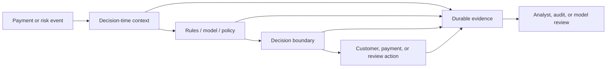

# Working Title

This template has two parts:

1. `Private Editorial Brief` helps plan the article.
2. `Public Article Draft` is the publishable post.

Before publishing, delete the private brief and any prompt text. The final post
should begin with the public title and opening scenario.

---

## Private Editorial Brief

Concept:

Target reader:

Reader pain:

Reader promise:

One-line thesis:

Concrete artifact:

- JSON record
- event timeline
- feature table
- decision trace
- retry sequence
- rule/model comparison
- audit replay flow
- analyst case timeline
- other:

Main diagram:

What makes this non-obvious:

Naive design to challenge:

Better design:

Tradeoff:

Failure mode:

What changes at scale:

What not to cover:

Memorable takeaway:

---

# Public Article Draft

# TITLE

## Opening Scenario

Start with a real situation, failure, investigation, incident, customer pain, or
design-review question.

Make the reader feel the problem before defining the concept.

Good openings usually include one concrete detail:

- a blocked customer
- a duplicate charge
- a disputed payment
- a model score nobody can explain
- a retry after a timeout
- an analyst reviewing a confusing case
- a compliance reviewer asking for evidence
- an alert firing during an incident

## Reader Promise

In one or two sentences, tell the reader what they will understand by the end.

Example:

> By the end, you will understand how to design fraud decisions so they can be
> reviewed later without slowing down checkout or exposing sensitive data.

## The Core Problem

Explain why this problem exists in real systems.

Cover the pressure that makes the problem hard:

- latency
- money movement
- fraud loss
- false positives
- analyst workload
- compliance or audit review
- customer trust
- operational failure

## The Mental Model

Give the simplest useful model of the concept.

Use plain language first. Introduce domain terms only after the reader has a
shape in their head.

Example:

```text
event -> context -> decision -> action -> evidence
```

## The Architecture

Use Mermaid to teach the system shape.

The diagram should show boundaries, data flow, sync vs async behavior, durable
evidence, replay paths, privacy boundaries, or failure points. It should not be
a decorative box chain.



After the diagram, explain:

- what happens synchronously
- what can happen asynchronously
- what data must be durable
- what must be deterministic
- where privacy boundaries exist
- what can be replayed later

## Concrete Example

Show a realistic artifact. This is mandatory.

Use one or more of:

- JSON decision record
- event timeline
- feature table
- retry/idempotency sequence
- rule/model comparison table
- before/after architecture
- analyst case timeline
- event stream example

Example:

```json
{
  "decision": "review",
  "reason_codes": ["new_device", "velocity_spike"],
  "model_version": "risk-model-2026-06",
  "evidence_captured_at": "2026-06-25T10:42:31Z"
}
```

## The Naive Design

Explain the common wrong or incomplete approach.

This section is what makes the article interesting. Readers learn when they see
why the obvious design fails.

Examples:

- storing only the final risk score
- generating explanations from current data instead of decision-time data
- treating logs as audit records
- putting a slow investigation workflow in the real-time path
- letting retries create duplicate financial actions

## The Better Design

Walk through the production-shaped approach.

Explain:

- the invariant being protected
- the data that must be stored
- the boundary between real-time and asynchronous work
- the privacy/security rule
- the operational signal that proves the system is healthy

## Tradeoffs

Explain the judgment call.

Compare:

- the simple version
- the mature version
- what to build first
- what to defer
- what changes at scale

## Failure Modes

Show how the design breaks.

Use concrete failure modes, not vague warnings:

- duplicate actions
- missing evidence
- stale data
- privacy leakage
- partial failure
- model/rule drift
- analyst confusion
- operational blind spots

## Design Review Questions

List the questions a senior reviewer would ask.

1. What invariant protects money movement or risk decisions?
2. What evidence exists after the decision?
3. Can the decision be replayed or explained?
4. What happens during retry, timeout, or partial failure?
5. What sensitive data is stored, masked, tokenized, or omitted?
6. What operational signal would show the system is degrading?
7. What does the naive design get wrong?
8. What changes at scale?

## Takeaway

End with one memorable design principle.

The reader should leave with a sentence they can repeat in their own design
review.
