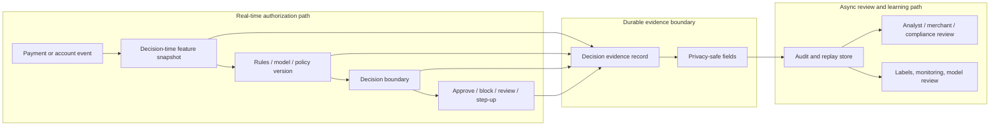

# Why Payment Fraud Systems Need Explainable Intelligence

Fraud decisions need evidence, not just scores.

A merchant opens the fraud review queue on Monday morning and sees two painful
payments sitting next to each other.

The first is a $1,200 order from a real customer that was blocked. Support is
angry because the customer has bought before. Sales is angry because the order
was legitimate. The fraud analyst opens the case and sees only a final answer:

```text
decision: block
risk_score: 0.91
```

The second case is worse. A risky payment was approved, shipped, disputed, and
lost. The chargeback arrived two weeks later. The team wants to know why the
system allowed it.

But now the evidence is moving under their feet. The customer has more history.
The device reputation feed has been updated. The model version has changed. The
rule that fired last week no longer exists in the same form.

The system was fast. It may even have been accurate on average.

But in both cases it failed a deeper test: nobody can reconstruct why the
decision happened from the evidence available at the time.

That is why payment fraud systems need explainable intelligence.

Not explainability as a dashboard afterthought. Not a vague label like "high
risk." Not a model score with no trail behind it.

Explainable intelligence means a fraud decision can be reviewed later using the
same decision-time evidence the system had when it approved, blocked, or routed
the payment to review.

By the end of this post, you should understand how to design payment fraud
decisions so they can be explained later without slowing down authorization or
exposing sensitive data.

We will walk through three ideas:

1. Why risk scores are not enough
2. What decision-time evidence looks like
3. How to preserve explainability without slowing down checkout

## Accuracy Is Not Enough

Fraud systems make decisions about money, trust, and customer experience in real
time.

At checkout, the system may have only a few hundred milliseconds to decide:

- approve the payment
- block the payment
- request step-up authentication
- send the payment to manual review
- allow the payment but monitor the account more closely

If the system is too permissive, fraud losses increase. If it is too strict,
good customers are blocked and merchants lose revenue. If it is too slow,
checkout conversion suffers.

That pressure pushes teams toward risk scores, rules, models, velocity counters,
device signals, and reputation networks. Those tools are necessary, but they
are not sufficient.

A fraud platform also needs to answer questions after the real-time decision:

- Why was this payment blocked?
- Why was this risky payment approved?
- Which rule or model version made the decision?
- Which features were visible at the time?
- Did the system use stale data?
- Did an analyst override the automated decision?
- Can this decision become a reliable label for future model training?

If the system cannot answer those questions, the fraud team is operating on
memory, screenshots, current database state, or partial logs.

That is not explainability. That is archaeology.

## The Mental Model

A fraud decision is not just a result. It is a chain of evidence.

```text
event -> decision-time context -> policy or model -> decision -> action
```

For example:

```text
card payment submitted
-> amount, account age, device history, velocity, dispute history
-> rules and model score
-> review
-> analyst queue entry
```

Explainable fraud intelligence means the system can inspect that chain later.
The most important phrase is **decision-time context**.

Do not explain yesterday's decision with today's data.

That mistake is subtle. Imagine a payment was blocked because the device looked
new. Two weeks later, the same device has more history and appears safe. If the
review tool reads only current device state, the analyst may conclude the block
made no sense. But at the time of the decision, the device really was new.

The inverse can also happen. A payment looked safe at authorization time, but
later account behavior made it suspicious. If the explanation uses the later
signals, the system appears smarter than it actually was.

That is the mental model to keep in your head:

> A good fraud system preserves what it knew then, not what it knows now.

## The Architecture: Two Paths, One Evidence Trail

An explainable fraud system separates the real-time decision path from the later
review path, while connecting them through durable evidence.



The real-time path must be fast and bounded:

```text
event -> features -> rules/model -> decision -> action
```

The review path can be richer:

```text
feature snapshot + policy version + decision + action -> evidence -> review
```

Those two paths should not compete.

The real-time path should not wait for a large explanation workflow, a warehouse
write, an analyst case, or an LLM summary. Checkout cannot afford that.

But the real-time path must write enough durable evidence for every later
workflow to tell the truth.

This is the key architectural move: explanation is not generated from thin air
after the fact. It is assembled from evidence captured when the decision
happened.

## What The Evidence Should Look Like

The exact schema depends on the business, but a useful decision record usually
has five parts:

1. The thing being evaluated
2. The features used
3. The policy, rule, or model version
4. The decision and reason codes
5. The action taken

A simplified example might look like this:

```json
{
  "decision_id": "fd_7M9K2",
  "subject": {
    "type": "payment",
    "payment_token": "pay_tok_8f3a",
    "merchant_token": "mrc_tok_91b2"
  },
  "feature_snapshot": {
    "amount_usd": 1200,
    "account_age_days": 6,
    "device_first_seen_hours_ago": 2,
    "attempts_last_10_minutes": 4,
    "prior_disputes_90_days": 0,
    "shipping_distance_from_billing_km": 860
  },
  "decision_engine": {
    "type": "hybrid_rules_and_model",
    "ruleset_version": "rules_2026_06_25",
    "model_version": "risk_model_2026_06_15"
  },
  "decision": {
    "action": "review",
    "risk_score": 0.87,
    "reason_codes": [
      "new_device",
      "velocity_spike",
      "amount_above_account_baseline"
    ]
  },
  "action_taken": {
    "payment_action": "hold_for_review",
    "customer_message": "additional_review_required"
  },
  "captured_at": "2026-06-25T10:42:31Z"
}
```

This record is not meant to expose everything. It is meant to preserve the
minimum useful truth:

- what was evaluated
- what the system knew
- which decision logic was used
- what action was taken
- when the evidence was captured

Now return to the two painful cases from the opening.

For a blocked $1,200 order, a record like this would let the analyst see more
than `risk_score: 0.91`. It would show what the system knew about account age,
device history, recent attempts, and the policy version used at the time instead
of forcing the team to reconstruct the decision from today's changed state.

For the approved payment that later became a chargeback, the team can inspect
the model version, ruleset version, and feature snapshot that existed at the
time. They may still conclude the system made the wrong call. But now they are
debugging a real decision, not arguing with a moving target.

Notice what it avoids:

- raw card numbers
- CVV values
- secrets or API keys
- raw device identifiers
- unnecessary personally identifiable information

Explainability and privacy have to be designed together. A fraud analyst needs
enough context to investigate, but not unlimited access to sensitive data.

## The Naive Design: A Score With A Thin Explanation

The naive design is to store the final score and maybe attach a few reason
codes later.

That sounds reasonable until the first serious review.

Many systems start with reason codes:

```text
new_device
high_velocity
amount_above_baseline
ip_country_mismatch
```

Reason codes are valuable because they turn a numeric score into something a
human can discuss. A merchant can understand "new device and unusual order
amount" better than "score: 0.87."

But reason codes alone are thin. They say what category mattered, not what the
system actually saw when the decision was made.

For example, `high_velocity` could mean:

- 2 attempts in 10 minutes
- 20 attempts in 10 minutes
- 5 failed attempts across 3 cards
- 4 shipping addresses on the same account

Those are different situations. A serious review workflow needs reason codes
plus selected feature values, policy versions, and action history.

The mistake is treating the reason code as the explanation. It is not. It is an
index into the explanation.

## The Better Design: Capture Evidence At The Decision Boundary

The better design is to capture a small, durable evidence record while the
decision is being made.

That record does not need every raw input. It does need enough stable context to
answer three questions later:

1. What did the system know?
2. Which decision logic did it apply?
3. What action did it take?

The maturity curve usually looks like this:

```text
reason codes
-> feature snapshots
-> model and ruleset versions
-> audit records
-> replayable decisions
```

You do not need full replay on day one. But if you never capture the evidence,
you cannot add trustworthy replay later.

## What Can Go Wrong

The most dangerous failure mode is a decision without evidence.

The system may still approve or block, but every later conversation becomes
weaker. Support cannot explain the customer impact. Analysts cannot tune rules
confidently. Modelers cannot trust labels. Engineers cannot debug drift.

The quieter failures usually fall into three groups.

First, the evidence can be stale or missing. A velocity counter may lag behind
the request stream, causing the system to undercount attempts during an attack.
Or the action may succeed while the evidence write fails, leaving behind a
financial decision that cannot be defended.

Second, the decision logic can lose its version history. If the system stores
only the score but not the model version, nobody knows whether the current model
would have behaved the same way. If a rule name stays the same while its
threshold changes, old decisions become hard to interpret.

Third, the explanation path can create a privacy problem. If teams dump raw
request payloads into logs "for debugging," they may expose sensitive data while
trying to make decisions easier to investigate.

The point is not that every fraud system needs perfect historical replay from
the beginning. The point is that decision evidence must be treated as part of
the product, not as optional debugging exhaust.

## The Design Tradeoff

There is a real tradeoff here.

The authorization path has to be fast. It cannot block on slow explanation
generation, analyst tooling, warehouse writes, or large enrichment jobs.

But if the system records too little during authorization, the later explanation
is fake.

A practical design is to keep the synchronous write small:

- decision id
- selected feature snapshot
- rule/model version
- action
- reason codes
- timestamp
- actor

Then richer workflows can happen asynchronously:

- analyst case creation
- merchant-facing explanation
- model monitoring
- label collection
- aggregate reporting
- replay experiments

In other words, do not put the whole investigation workflow in the checkout
path. But do put the evidence handle there.

That handle is what lets the rest of the system tell the truth.

## What I Would Ask In A Design Review

If I were reviewing a fraud decisioning design, I would ask:

1. Can every automated decision be traced to decision-time evidence?
2. Are feature values snapshotted, reproducible, or lost after the request?
3. Are model and ruleset versions stored with the decision?
4. Can analysts distinguish model output, rule output, and manual override?
5. What happens if the decision succeeds but evidence persistence fails?
6. Which fields are masked, tokenized, hashed, or omitted?
7. Are explanations generated from original evidence or current state?
8. What metric tells us decisions are happening without evidence?
9. Can labels be connected back to the exact decision they describe?
10. What can be replayed today, and what is intentionally not replayable yet?

These questions are not academic. They decide whether a fraud platform can
learn from its own decisions.

## The Takeaway

Explainability is not a paragraph in the UI. It is not a model card alone. It
is not a list of generic reason codes added after launch.

In fraud systems, explainability is an architecture property.

The system has to preserve decision-time context, decision logic, action
history, and privacy-safe evidence while the decision is happening. Otherwise,
the later explanation is just a reconstruction from whatever data happens to
exist now.

Fraud systems do not become trustworthy only by being accurate. They become
trustworthy when their decisions can be explained, reviewed, corrected, and
improved.

The principle I would keep on the design doc is this:

> Do not make a financial risk decision unless you are willing to preserve the
> evidence needed to defend it later.
