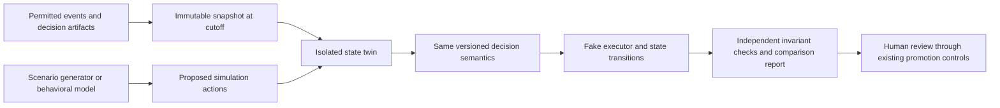

# AgenTwin Research And A THAAP Trust Twin

**6 October 2026 — recommendation for a bounded product experiment.**

**Scope clarification:** the founder subsequently clarified that the intended
invention is an AI simulation agent for each real user. The
[Personal Financial Agent Twins proposal](THAAP_PERSONAL_FINANCIAL_AGENT_TWINS.md)
is the current recommendation for that concept. The Trust Twin below remains
supporting sandbox/control research; it does not replace the personal agent.

**Earlier sandbox recommendation:** build toward a THAAP Trust Twin: a tenant-scoped environment for
reconstructing payment context, exercising adversarial sequences and evaluating
candidate controls before they influence money movement. Begin with deterministic
state and scenario execution integrated into the planned supplier demonstration.
Evaluate learned behavioral simulation as the next experiment. Do not place an
LLM twin in the synchronous authorization path or let inferred preferences grant
payment authority.

This is a THAAP design recommendation, not an implementation or a claim that
Amazon's framework has been ported. The final trust/authorization research and
its [coverage map](THAAP_RESEARCH_COVERAGE.md) retain their requirements. The twin
extends the decision laboratory in the [strategy](THAAP_WINNING_STRATEGY.md).

## What the name refers to

The exact-name research located is **AgenTwin: An End-to-End Framework for Building
Agentic Twins of Mobile Users**, by Amazon researchers and a Stanford collaborator,
marked COLM 2026 Workshop on Agent Behavior. It combines persona generation,
contextual memory, joint choice evaluation and mobile-device control.
[Publication](https://www.amazon.science/publications/agentwin-an-end-to-end-framework-for-building-agentic-twins-of-mobile-users).

The paper evaluates next-event behavior using MovieLens and two internal shopping
datasets. It reports a 19% relative average F1 improvement over Generative Agent
on one proprietary dataset, not a 19-point gain or fraud result. Its mobile-control
success rate is 91.7% on 72 trajectories; Appendix A.4 reports approximately two
minutes per simulation iteration. Some baselines win individual settings. The
privacy appendix describes prompt constraints. These are authors' results, not
reproduced here. [Paper, sections 3/5 and appendix](references/AGENTWIN_MOBILE_USER_TWINS_2026.pdf).

I did not verify an official reusable code release/license in this search. The
similarly named PyPI `agentwin` is a Windows remote-management tool, not this
research implementation. A separate [AgentTwin identity offering](https://agenttwin.ai/)
uses a similar name. This recommendation assumes the Amazon paper is the intended
reference; it is not an integration recommendation for either unrelated product.

## What the evidence supports

The research supports investigating behavioral simulation. It does not establish
that a twin can authenticate a payment, recognize fraud, faithfully model a
particular AP team, or predict global customer responses. Our inference is that
this is useful inspiration for an offline experiment, not evidence for deploying
a predictive authorization system.

A separate Amazon study reports that, across 67 historical marketing A/B tests,
an off-the-shelf simulator overestimated effect magnitude. Calibration helped,
but roughly 70% directional agreement was not clear evidence of directional
signal once simple baselines and experiment noise were considered. This directly
motivates checking simulation predictions against real outcomes rather than
accepting plausible narratives. Only the publication abstract was reviewed for
this second study. [Validation framework](https://www.amazon.science/publications/can-ai-agents-simulate-a-b-test-outcomes-a-validation-framework-for-agentic-experimentation).

Historical rule backtesting is already an established product capability: Stripe
describes Radar backtesting and simulation. Our proposed advance must be measured
in the whole trust/authority workflow and its failure sequences, rather than
claimed from the word "twin." [Stripe's guide](https://stripe.com/guides/improve-fraud-management-with-radar-and-stripe-data).

## The THAAP product opportunity

A digital twin is a model of a particular system whose state and behavior can be
examined under specified conditions. For THAAP, distinguish three capabilities:

| Capability | What it answers | Recommendation |
|---|---|---|
| Evidence/state twin | What did we know about this payment, supplier, actor and authority at a particular cutoff? | Build from durable events, versioned objects and temporal graph; this is closely aligned with the first product |
| Behavioral simulator | How might an operator or agent respond to this challenge, delay or changed policy? | Bounded learned experiment; predictions need validation and uncertainty |
| Autonomous surrogate | What may a software agent actually do on someone's behalf? | Govern through explicit intent and mandates; a behavioral twin cannot confer those permissions |

Working name: **THAAP Trust Twin**, not a claim to own the AgenTwin brand or
reproduce a human mind. A synthetic role model should be called a simulator;
claim a customer-specific behavioral twin only after demonstrating fit on that
customer's permitted data. Profile metadata alone is not a behavioral twin.

The product experience could let a risk owner select a supplier or task, choose
a historical point, and compare policy A and B in an isolated world. The report
shows changed decisions, unmet obligations, simulated action sequences, exposure,
unknown outcomes and the exact assumption responsible for each difference.

Example: a real invoice follows a destination change. The operator compares:

- an independently verified legitimate change;
- the same payment with a forged verification assertion;
- an account substitution after approval;
- a delayed graph projection;
- a timed-out executor that may already have accepted the payment.

The first useful result is whether the control behaves correctly in each case.
Later, a validated behavioral model can estimate likely follow-up actions or
verification workload. It cannot turn an estimated willingness to approve into
an actual approval, nor can a simulated callback verify a real bank account.

For the agent extension, simulate a compliant purchasing agent, an injected goal,
repeated small amount increases, concurrent purchases, mandate revocation and
a paid-tool retry loop. Compare actual sandbox state against the frozen promises.
A fluent agent report is not proof that a payment was blocked or a budget held.

This creates a product hypothesis with global potential: customers can test their
payment-control system against both operational changes and agent behavior before
rollout. Evidence that would support it includes faster policy review, additional
confirmed failure cases and useful prediction on held-out customer workflows.
The experiment must establish those benefits; the name supplies none of them.

## Proposed architecture and invariants

The simulation can contain proposed malicious actions. Its execution environment
must be incapable of real financial effects. Use separate credentials, database
write scope, queues and signing audiences; a simulation result cannot issue a
production-valid permit. Workers have no production payment credentials or network
route to a live executor. Sharing an evaluator library does not justify sharing
an execution identity.

| Boundary | Design requirement |
|---|---|
| Truth versus prediction | Observed evidence, inferred profile, synthetic event and hypothetical outcome have distinct provenance and storage semantics |
| Tenant isolation | Every snapshot, memory retrieval, run, model artifact and report is scoped; no pooled customer memory by default |
| Historical knowledge | Snapshot event/ingestion cutoffs, policy, feature and model versions; later information cannot leak into the original state |
| State evolution | Scenario actions advance a separate clock/state; cannot overwrite the original ledger or mark historical verification complete |
| Model authority | Generated actions are untrusted proposals; policy and deterministic constraints remain outside the model |
| Independent judging | Assertions inspect durable state and invariants; the generating model cannot certify its own success |
| Reproducibility | Retain normalized inputs, scenario version, model/prompt version, sampled outputs, seed where supported and tool transcript; a seed alone does not guarantee identical hosted-LLM output |
| Privacy | Minimize records, redact before model access, enforce deletion/retention and artifact access; prompt instructions alone are insufficient |
| Cost and availability | Asynchronous jobs with step/token/cost/runtime limits, cancellation, resume identity and a visible incomplete result on exhaustion |
| Promotion | Simulation reports are evidence for a separate review; never automatically deploy policy, train on synthetic labels as truth, or expand mandates |

Avoid building mobile-device control for the first experiment: THAAP's immediate
subject is the structured payment and control workflow. API-driven scenarios are
more direct. Browser/UI simulation can later test a demonstrated investigation
usability question. Do not infer age, gender, ethnicity, emotions or other sensitive
personal traits to authorize payments; the initial simulator uses workflow roles,
permitted actions and observed operational facts.

## Reuse before adding infrastructure

Inspected current source includes:

- [RiskSimulationService](../../apps/payments-api/src/main/java/com/thaap/payments/simulation/RiskSimulationService.java):
  frozen candidates, cohort/as-of boundaries, version references and durable runs.
- [OfflineReplayDatasetService](../../apps/payments-api/src/main/java/com/thaap/payments/replay/OfflineReplayDatasetService.java):
  immutable cutoff/projection lineage and label-availability boundaries.
- [RiskSimulationReportService](../../apps/payments-api/src/main/java/com/thaap/payments/simulation/RiskSimulationReportService.java):
  report/progress reconciliation, report digests and scoped execution ownership.

These are reusable patterns, not an existing AgenTwin implementation or proof of
the new domain. Extend through accepted module/API boundaries. Retain Java/Postgres
for authoritative state and the planned Neo4j projection; introduce an asynchronous
Python model worker only when the behavioral experiment requires it. A vector
store is optional implementation detail, not the first deliverable. Do not create
a second ungoverned event ledger, replay engine or model registry.

## An executable evaluation plan

Compare three systems on the same frozen tasks and evidence: existing deterministic
replay; replay plus scripted/stochastic role behaviors; then a learned simulator.
The third must justify its additional latency, cost and uncertainty. Add ablations
without long-term memory and without adaptive behavior to identify what helps.

Keep three types of evidence separate:

| Evaluation | Measure | What it cannot prove |
|---|---|---|
| Control correctness | All 11 final-research scenarios plus temporal, tenant, forgery, ambiguity, recovery and simulation-escape negatives; durable postconditions | Frequency of real attacks or future fraud-loss reduction |
| Scenario discovery | Additional independently confirmed boundary failures beyond equal-budget scripted/property tests; duplicates excluded | That synthetic attacks represent the real fraud distribution |
| Behavioral fidelity | Held-out real next actions, challenge completion and delay distributions; calibration, subgroup/workflow errors and uncertainty versus simple baselines | Causal response to a never-observed policy change without further assumptions/evidence |

For learned evaluation, split by time and hold out supplier/organization/task
families as appropriate. Freeze training, calibration and final test sets before
model selection; do not calibrate on the test outcomes. Report rare/unknown
outcomes and representation gaps. Historical blocked transactions often lack the
outcome they would have had if allowed; do not fill that gap with generated labels.

Pre-register a practically useful improvement, acceptable errors, compute budget
and stopping condition for each experiment. Require meaningful held-out gains
with uncertainty at the relevant case/customer level, not a headline score from
many correlated simulated runs. Repeating an LLM 10,000 times estimates variability
inside that model, not the uncertainty of the real world. Controlled policy
rollout remains a separate decision even when simulator results look promising.

Initial research success can be one previously untested, independently reproduced
failure sequence or a measurable reduction in analyst evaluation effort. That is
a proposed experiment criterion, not a current result. A learned component that
fails to beat the simpler baseline should be revised or removed while the useful
state/replay laboratory remains.

## Implementation sequence and decision

1. **First supplier build:** freeze snapshot/export and simulation-only execution
   boundaries alongside the existing trust/verification/graph/policy work. Make
   one legitimate change and one substitution fully replayable. This supports
   the original product rather than adding a separate prerequisite platform.
2. **First Trust Twin experiment:** fork an authorized snapshot into isolated
   state; run the mandatory supplier failure variants against candidate policy;
   show evidence, exact state differences, limitations and cost in the console.
   No learned model is needed for this first proof.
3. **Agent-authority extension:** add bounded role behaviors and injected failures
   after the complete supplier demonstration. Prove the delegation, incremental,
   concurrency, revocation and loop scenarios from the final research.
4. **Learned behavior experiment:** owner is the Model and investigation assistance
   slice, supported by the Replay/Agent slices. Start when permitted histories,
   a frozen evaluation set and the simpler baseline exist. Compare next-action/
   workflow predictions first; causal policy-impact forecasting requires a further
   validated experiment. No guessed calendar or claim of production readiness.
5. **Customer-facing expansion:** expose validated capabilities for policy review,
   integration testing and agent qualification. Region/workflow-specific coverage,
   support and economics still need proof; no global personal-data pool is assumed.

**Recommendation: yes to a bounded THAAP Trust Twin; yes to researching AgenTwin's
behavioral ideas; no to installing an unverified similarly named package or making
a predicted human choice the authority to move money.** This is a recommendation
for the next implementation plan, not a claim that the feature has been approved,
built or tested. It introduces no waived invariant or accepted implementation debt.

## Founder extension: Financial Agent Twins

The founder proposes a personalized financial-behavior model: compare an incoming
transaction with expected behavior learned from permitted history, then feed the
divergence into risk assessment. This is a valuable extension of the offline
Trust Twin. It adds a potential runtime signal, subject to separate model proof.

Related work already models static profiles and time-dependent behavior for fraud
and studies explainable sequences across domains. The abstracts were reviewed,
not their full experimental results. [Time-attention research](https://arxiv.org/abs/1912.11760),
[explainable cross-domain sequences](https://arxiv.org/abs/2201.01004).
Feedzai also describes personalized profiles built from behavior, transactions and
cross-channel interactions. This is evidence of existing product overlap, not an
independent efficacy assessment. [Vendor description](https://www.feedzai.com/solutions/transaction-fraud/).
The invention target for THAAP is connecting this personalized signal to upstream
evidence, exact authority, guided verification and replayable control decisions.

### What the model should estimate

Represent expected behavior as a range or conditional distribution, rather than
one imaginary transaction a twin says the person would make. Condition on the
history available before this request and independently supported context. Model
amount/currency, timing, destination relationships, device/session signals and
sequences jointly where evidence supports it. Avoid simply summing correlated
"new device" and "new location" flags as independent proof.

A low likelihood under an expected-behavior model indicates surprise. It is not
by itself the probability of fraud. Fraud probability additionally needs relevant
fraud/legitimate outcomes, prevalence-aware evaluation and calibration. Generating
100 plausible payments and finding no exact match does not establish that the
real payment is fraudulent. A plausible LLM explanation is not a calibrated score.

For the founder's illustrative INR 270,000 payment at 03:17 from a new device,
unusual merchant and different country, first check the source/meaning of those
facts. Device recognition can reset; country inferred from IP is uncertain;
timing needs a reliable timezone; amount depends on currency, transaction purpose
and relevant payment history. Treat travel or a new phone as possibilities, not
verified facts invented to explain away an anomaly.

The model could return divergence by factor, joint evidence, profile version,
cutoff, coverage, freshness and confidence/abstention. The policy separately
considers mandate limits, payee verification, authentication, intent and other
risk signals. Strong anomaly may justify an appropriate challenge or review under
customer policy; normal-looking behavior cannot override missing authority.

### Two separate product paths

- **Offline Trust Twin:** simulate sequences and policy changes, test failures and
  study potential responses. Generated behavior stays synthetic and isolated.
- **Runtime behavioral model:** consume a versioned compact profile and bounded
  inference, initially in shadow. It supplies a risk feature; it cannot write
  verification evidence, grant authority or produce executable payment permits.

Do not perform a full conversational role-play for every payment. Start with
robust per-entity statistics and deterministic features, then compare a supervised
baseline with sequential or generative methods. Use asynchronous profile updates;
version/freshness checks and a documented missing-profile fallback belong in the
runtime contract. A shared model with entity-specific state may be more practical
than a separately trained neural model for every customer.

### Failure cases and evaluation

| Case | Required treatment |
|---|---|
| Legitimate novelty | Travel, a new device or a large planned purchase can be unusual; measure unnecessary challenge and review burden |
| Familiar-looking fraud | An attacker can imitate habits; compromised supplier instructions and socially engineered payments still need independent controls |
| Sparse history | Report insufficient evidence; test a permitted cohort/global baseline rather than manufacture a confident personal profile |
| Poisoned adaptation | Do not immediately learn an authorized/pending payment as legitimate; separate provisional events from matured labels and support rollback/rebuild |
| Behavior drift | Compare recent and longer history, detect change and validate adaptation; no automatic self-promotion or assumption that every change is malicious |
| Data visibility | A merchant sees only part of a person's activity; describe the profile's actual scope and do not promise a complete financial life |
| Privacy and tenancy | Rights, purpose, retention and isolation apply to history, embeddings and inferred preferences; no silent cross-customer identity joining |
| Feedback bias | Holds/declines alter later observations; unknown outcomes remain unknown, not generated positive/negative labels |

Evaluate time-ordered held-out data and the relevant known/new entity splits.
Compare detection at the same legitimate-challenge/review budget, plus calibration,
latency, cost, cohort errors and cold-start coverage. Ablate behavioral memory and
sequence modeling against simpler features. Test poisoning, out-of-order events,
label correction, stale profiles and cross-tenant retrieval as boundary families.
Show factors backed by actual features; an explanatory LLM cannot invent motives.

### Recommended sequence

Retain this as a targeted ML hypothesis. In the first supplier product, begin with
organization-supplier payment cadence, amount ranges, destination-change history
and approval sequences. In the agent extension, add task spend, tools, mandate
usage and retries. A consumer "Raj financial twin" requires an explicitly scoped
customer data integration and human/principal mapping; the current merchant and
supplier data do not automatically supply it.

Owner: Model and investigation assistance, supported by Trust and verification,
Agent authority and Temporal graph/replay. Start a bounded offline prototype once
versioned histories and evaluation contracts exist; synthetic fixtures can prove
the plumbing before real data is available. Shadow and live influence require
separate evidence. This preserves the supplier-first product while building a
reusable path to financial behavioral twins; it does not freeze a new implementation
promise, accept debt or claim a winning model already exists.

## Review scope

Reviewed the AgenTwin paper's method, experiments and appendices; extracted its
18 pages and visually inspected result Table 1 (page 5) and the page 16 runtime/
emotion table. The comparison study was reviewed at abstract level. Checked Stripe's
primary guide and selected local simulation/replay code. No model run, benchmark
reproduction, package installation, external outreach, paid API call, deployment
or product code change occurred. Source metadata and hash are retained in
[AGENTWIN_SOURCE.json](references/AGENTWIN_SOURCE.json).

Explain back: if a twin predicts that an employee would approve a payment, what
additional evidence and authority are still required before THAAP can permit it?

Document verification: preserved-reference hash/bytes, original research source
hashes, local links, learning checks, ordinary repository readiness and whitespace
checks passed with exit 0. These validate document/repository consistency, not a
Trust Twin implementation or the paper's experimental results.
