# THAAP: Strategy to Earn a Global Payment-Trust Business

**Research synthesis v1.2 — 6 October 2026; final-research coverage reconciliation**

**Recommendation:** build THAAP into a programmable trust and authorization
platform for human and AI-initiated economic actions. Its defining experience
should connect intent, evidence, authority, execution and learning in one
reconstructible loop. Prove that invention through a remarkable working product;
use supplier-payment changes as the first commercial entry point, then expand
across workflows and markets. Preserve the existing payment-risk foundation.

This is the consolidated strategic recommendation requested by the founder.
It resolves the research into choices, experiments and proposed execution gates.
It does not declare the new capabilities implemented or supersede accepted
runtime contracts. [The implementation master plan](../IMPLEMENTATION_MASTER_PLAN.md)
remains authoritative until the proposed amendments in section 11 are adopted.
No document can guarantee commercial success; this plan makes the important
assumptions testable and directs effort toward earning it.

The founder has confirmed [THAAP_TRUST_AUTHORIZATION_RESEARCH](sources/THAAP_TRUST_AUTHORIZATION_RESEARCH.md)
as the final research baseline. The [coverage and reconciliation map](THAAP_RESEARCH_COVERAGE.md)
accounts for every source section, 38 requirement groups and all 11 mandatory
end-to-end scenarios. The shorter blueprint supplies compatible background.
Version 1.2 restores Neo4j to the first complete supplier demonstration alongside
OPA, and makes the detailed agent and operations requirements explicit. Source
examples still require contract/ADR reconciliation and safety corrections.

For the next implementation session, use the consolidated
[Product And Implementation Handoff](THAAP_PRODUCT_IMPLEMENTATION_HANDOFF.md).
Its HD-01–HD-13 choices resolve subsequent source ambiguities; the strategy below
continues to supply product, commercial and global-expansion rationale.

## The invention we should pursue

The founder's objective is a globally significant product. A first AP customer
is a route into that market, not the scope of the ambition. Incumbent overlap
sets the comparison we must beat; it does not establish that the market should
have only one winner. The earlier version put commercial qualification ahead
of a sufficiently concrete invention thesis. This revision corrects that order
while keeping the evidence and safety requirements.

**Product thesis: THAAP should turn a proposed economic action into an explicit,
evidence-backed authorization that stays bound to what actually executes—and
show people exactly how to resolve uncertainty before the action proceeds.**
This is a proposed integrated product advantage, not a claim that its components
are unprecedented or that competitors cannot deliver them.

A user should be able to answer five questions in one workspace: What is being
requested? What changed? What authority and evidence apply? What must happen
next? What actually happened? Developers should access the same semantics through
an API. A supplier payment and an agent purchase have different rules, but both
need exact intent, bounded authority, trustworthy evidence and durable outcomes.

### Five capabilities that make the thesis concrete

| Capability to invent and refine | Observable product experience | Required experiment |
|---|---|---|
| Structured intent and authority | A human or agent proposes an action with exact destination, amount, purpose and limits; THAAP identifies the evidence and permissions that apply | Two local workflow adapters use the same core contract without weakening either domain's rules. Natural-language extraction remains an untrusted draft until validated. |
| Continuous evidence state | An account, credential or mandate change visibly invalidates affected outstanding authorizations at the defined boundary | Inject late, duplicate, stale and conflicting events; show what changes, what is held, and why. Never imply that external settlement can be recalled. |
| Guided resolution | A held legitimate action becomes executable through specific independent verification or additional approval; the user sees the next required step | Complete both legitimate and malicious journeys, measuring effort and ensuring the attacker cannot satisfy the check using the compromised channel. |
| A decision laboratory | An investigator reconstructs the original decision and separately explores how a different policy or evidence set would change it | Preserve historical knowledge and artifacts; hypothetical replays cannot mutate authority or claim to predict outcomes that were never observed. |
| Bounded execution and feedback | The exact authorized action is consumed once within the agreed integration; retries, revocation and unknown outcomes remain understandable | Forced database interleavings and a hostile fake executor prove scoped behavior; later customer integrations need their own end-to-end proof. |

The potential breakthrough is the coherence of this loop: a change in evidence
leads to an understandable control, a legitimate path to resolution, an enforceable
action and a useful learning record. Evaluate the whole experience against a
rule engine plus manual verification, not just isolated API latency or model scores.
Research must identify where that combination delivers a substantial advantage;
we should not rename ordinary components and call that invention.

### The first remarkable demonstration

Build a local, reproducible demonstration with two connected stories. Complete
the supplier story through API, PostgreSQL, temporal Neo4j projection, OPA,
UI, permit, fake executor, outcome and replay before extending it with agents:

1. A legitimate supplier changes its account. THAAP explains the missing proof,
   binds independent verification to the exact new version and lets the approved
   payment proceed through a fake executor. An attacker then substitutes another
   version after approval; the old authorization cannot release it.
2. An agent proposes a purchase within a delegated task budget. Concurrent
   attempts compete for the same remaining authority; only the permitted effect
   can proceed. Revoke the mandate or lose an executor response and show the
   resulting hold, reconciliation and audit trail without inventing an outcome.
3. Reconstruct each original decision, compare a hypothetical policy, and show
   the difference between simulation, authorization and external outcome.

These are technical invention targets, not implemented capabilities. The second
story is a bounded local experiment in reuse, not a second commercial launch or
an assertion of AP2 conformance. Use synthetic identities and a fake executor;
real verification, money movement and customer claims retain their own gates.

The demonstration earns its place if it makes an important capability tangible,
proves the hard boundary cases and reveals useful reuse between the workflows.
A polished screen around a score does not satisfy this bar. Its adoption path
then tests integration speed, investigation effort and willingness to pay.

### Research extension: THAAP Trust Twin

The [AgenTwin assessment](THAAP_AGENTWIN_ASSESSMENT.md) recommends extending this
decision laboratory with an isolated state twin and adversarial workflow
simulation. Begin with existing replay and deterministic scenarios; evaluate
learned behavior only against permitted data and simpler baselines. Simulated
facts cannot verify a real destination or grant payment authority. This is an
additional research recommendation, not a new prerequisite that replaces the
final research's supplier-first implementation sequence.

The founder’s subsequent clarification is a broader personal simulation agent:
[Personal Financial Agent Twins](THAAP_PERSONAL_FINANCIAL_AGENT_TWINS.md). Pursue
a bounded research prototype that predicts a specific user’s financial choices
and tests its fidelity against simpler models and swapped-person controls. This
is a proposed research track; it neither establishes predictive performance nor
changes the core demonstration’s implementation commitments.

The supplemental [Agent Trust Runtime review](THAAP_AGENT_TRUST_RUNTIME_REVIEW.md)
adds an agent-focused control story, human-fallback provenance and containment
scenarios. Version 1.2 resolves the major unknown-exposure, Neo4j, approval-binding
and scenario-isolation conflicts. The latest review records source coverage and
the remaining contract translations governed by the implementation handoff.
It does not replace the primary research baseline or personal-twin research.

### Build globally useful foundations now

Use explicit currencies and exact amount units, tenant-scoped identities,
versioned contracts, locale-independent event time, separate display formats,
and replaceable source/verifier/executor adapters. Define provenance, retention
and residency boundaries before introducing cross-customer learning. These are
concrete portability choices; country-specific verification and operations still
need qualification before launch. Start from existing repository capabilities
and add abstractions only when the two demonstration contracts require them.

Run bounded invention and customer learning concurrently. Missing a design partner
must not automatically halt reusable local engineering. Every invention cycle
needs a working artifact, comparison baseline, proof of the claimed behavior and
a review decision. Change a weak hypothesis; retain the global objective. Customer
gates control commercial rollout, while technical gates control what we build and
what we can honestly claim about it.

## 1. The decisions I recommend

1. **Demonstrate the invention through a real workflow.** Start with supplier bank-account
   changes and the payments that follow them. Help a finance team determine
   what changed, whether the exact destination was independently verified,
   who authorized release, and what happened afterward.
2. **Choose one customer profile.** Initially target software-enabled B2B
   businesses with centralized accounts payable, recurring supplier payments,
   and an engineering owner who can expose change history and control payment
   release. The budget owner is the CFO/controller or treasury leader; AP is
   the daily user. Select one ERP/AP integration and one jurisdiction with the
   first qualified partner. Do not launch against six buyer categories at once.
3. **Compete on a measured workflow advantage.** Our hypothesis is that a
   tightly integrated, replayable control loop can reduce investigation effort
   and prevent release to an unverified changed destination. Neither benefit
   is proven yet. Provider independence, explainability and AI are insufficient
   differentiation on their own.
4. **Keep THAAP outside custody and payment processing.** The customer/provider
   owns bank credentials and execution. THAAP owns the decision, obligations,
   evidence and enforcement contract. A local execution simulator proves that
   contract; a production gate requires a separately qualified integration.
5. **Retain the current codebase and proof.** Extend Java 25/Spring Boot 4,
   PostgreSQL, the event/replay substrate and React/Vite workspace. Do not
   downgrade or rewrite the product to match a research document's stack list.
6. **Make trustworthy data precede learned decisions.** Deterministic evidence
   checks come first. Governed tabular ML follows adequate labels and a real
   baseline. GenAI assists investigation with citations and bounded tools.
7. **Run customer discovery alongside engineering immediately.** Customer
   access, integration feasibility and willingness to pay must be tested before
   building the entire graph/agent/protocol platform. Use the next 90 days as a
   decision window, not a promise to finish a global platform.

The first product milestone is the reproducible demonstration above, with
proof of its authority, evidence and recovery boundaries. It can progress before
a commercial partner signs. The first commercial milestone is one qualified, paid pilot with agreed success
criteria and an explicit renewal decision. The next is a second customer using
substantially the same product. Global expansion becomes credible when this
process repeats with acceptable operating cost and safety.

## 2. What the research establishes—and what it does not

Both supplied blueprints describe a trust and authorization layer between an
actor's proposed action and its economic consequence. Their useful common core
is structured authority, upstream trust events, versioned evidence, deterministic
policy, investigator workflows and replay. The [detailed assessment](2026-10-06-RESEARCH_ASSESSMENT.md)
contains the source-by-source design review and additional failure conditions.

The problem is plausible and supported by primary sources. J.P. Morgan explains
how fraudulent supplier instructions can pass ordinary approval workflows, and
separately argues for enforceable agent authority with pending exposure included
in limits. These establish reasons to investigate the problem, not evidence that
THAAP has customers or a unique solution. [B2B trust analysis](https://www.jpmorgan.com/insights/fraud/fraud-prevention/ai-powered-b2b-fraud-is-forcing-companies-to-rethink-trust),
[agent controls](https://www.jpmorgan.com/payments/newsroom/ai-agent-controls-payments).

Important unknowns remain: founder access to buyers; team capacity; budget and
runway; permission to obtain usable data; exact verification coverage and cost;
integration lead time; procurement requirements; and willingness to replace or
supplement an incumbent. The founder reaffirmed the global ambition but did not
supply those inputs. Planning therefore assumes a founder-led effort with AI
engineering assistance, not a funded team, existing partners or staffed 24/7
operations. No model training, outreach, paid service or deployment is authorized
merely by its appearance in this strategy.

Research confidence must stay explicit:

| Evidence class | What we have | What it can establish |
|---|---|---|
| Supplied research | Two distinct blueprints; the longer one also has a Markdown export | Candidate architecture, requirements and questions |
| Repository evidence | Existing plans, selected implementation, accepted ADRs and recorded closure evidence | A reusable local payment-risk foundation; not new live customer outcomes |
| Current primary sources | Standards and vendor documentation checked on 6 October | Documented protocols/capabilities and competitive overlap |
| Customer evidence | None supplied for this review | No validated segment, price, adoption or advantage yet |
| THAAP production/model evidence | No new live pilot or trained-model evidence produced here | No claim of fraud-loss reduction, model superiority or global readiness |

## 3. The competitive reality changes the strategy

Our earlier research focused heavily on Stripe and Mastercard. The immediate
supplier-payment market includes specialist competitors. We must evaluate them
alongside a customer's existing ERP approvals and manual verification process.
The table records provider descriptions, not independently tested performance.

| Alternative | Documented overlap | Implication for THAAP |
|---|---|---|
| Stripe Radar | Risk scores, rules, review and insights; Stripe also describes using Radar for payments processed by other providers. [Radar documentation](https://docs.stripe.com/radar/transaction-risk-prevention), [multiprocessor guide](https://stripe.com/guides/evaluating-and-managing-multiple-payment-providers) | Do not sell a generic score or claim that operating beyond one processor is unique. |
| Trustpair | APIs for supplier checks, vendor-file audits, pre-bank payment checks and change webhooks. [API documentation](https://docs.trustpair.com/docs/general-information) | A verification API and ERP integration are competitive requirements, not a new category. |
| Eftsure | Vendor banking verification and checks through onboarding, changes and payment processing. [Product FAQ](https://www.eftsure.com/faq/) | Independent verification access and operational service quality matter. We cannot assume we have equivalent data. |
| PaymentWorks | Bank verification for new registrations and bank-information updates, including fraud-operations review. [Product documentation](https://help.paymentworks.com/knowledge-base/bank-verification-status-for-customers-not-on-payments) | Human verification work is part of the product cost; it does not disappear because we build an API. |
| Trustmi | Correlation across email, ERP, invoices and vendor records, payment verdicts, evidence and investigation. [Product description](https://trustmi.ai/products/behavioral-ai-payment-security/) | Upstream evidence, cross-system context and explanations are already competitive territory. We need a narrower measured advantage. |
| Mastercard / agent ecosystem | The Agent Pay framework spans identity, intent, controls, execution and intelligence. [Framework overview](https://www.mastercard.com/global/en/news-and-trends/Insights/2026/mastercard-agentic-commerce-trust-white-paper.html) | Agent authorization is strategically relevant but incumbents are building it too. Interoperability is a requirement, not a moat by itself. |

We have not performed competitor sandbox tests, pricing/procurement comparisons
or customer reference calls. Do not infer that a competitor lacks a feature
because its public page does not mention it. Vendor claims about zero losses,
coverage or percentage improvements are not adopted as neutral benchmarks.

The opportunity to test is specific: a buyer whose current controls cannot
reliably bind a changed destination, its independent verification, a particular
approved instruction and the actual release—and who finds THAAP easier or more
useful to integrate and operate. If customers show that an incumbent already
does this adequately at acceptable cost, identify a stronger product advantage
or another entry point. A failed positioning hypothesis is not evidence against
THAAP's global objective.

### Candidate entry points

| Candidate | Why attractive | Hardest obstacle | Decision |
|---|---|---|---|
| General merchant/card fraud scoring | Closest to the current simulator | Real fraud data, incumbent distribution and measurable decision-quality advantage | Keep the foundation; do not make an unsupported model-superiority pitch. |
| Supplier-change control and investigation | Concrete input-integrity failure, clear finance owner, useful deterministic first workflow | Verification/data access, existing competitors and release-path integration | Recommended first discovery and product experiment. |
| Agent spending authorization | Tests reuse of the invention beyond AP | Authority semantics, protocol churn and uncertain buyer budget | Include a bounded local demonstration; commercial rollout follows qualification of this workflow. |

This ordering is a judgment under uncertainty, not a market-size calculation.
Strong customer access to a different lane can change it. We should learn that
early rather than defend a preferred architecture against the evidence.

## 4. The first offer and customer qualification

Working offer: **“Know what changed before a supplier payment, verify the exact
destination, and release under controls you can audit.”** Before an enforced
pilot, describe the product as
decision support and evidence management; do not promise that it stops funds.

Select a partner with all of the following:

- A finance sponsor owns recurring pain or measurable verification/review effort.
- One AP/ERP system exposes authenticated supplier-account changes and versions.
- The team has an independent verification method and can explain its limitations.
- An engineer owns the release boundary and can test a THAAP-dependent path.
- An operator can review exceptions and supply adjudicated outcomes.
- Data permissions, retention, security review and a budget decision have owners.

Reject an initial enforced pilot that depends on untracked manual bank-portal
uploads, unaudited spreadsheet edits, unknown source provenance, or nobody
owning failures. Such a customer may still qualify for a bounded advisory study,
but it cannot substantiate bypass-prevention claims.

First geography follows access to a qualified partner and adequate verification
coverage. The founder's location is not evidence of the best market. Begin with
one legal/customer operating context, one processing region and one currency
workflow. Record provider coverage limitations; support for a currency code is
not evidence that we can verify accounts or operate compliantly in that country.

### Discovery that can change our mind

Target eight buyer/operator conversations and two integration/security reviews
in the first two weeks. These are activity targets, not a statistically valid
market survey. Request concrete examples of the last account change or incident,
current screens, verification steps, elapsed time, approval/release authority,
existing vendors, procurement requirements and what would justify a paid trial.
Prefer a workflow walkthrough over “Would you use an AI fraud product?”

The first decision gate requires three independent descriptions of recurring
pain, two organizations willing to provide appropriately permitted examples,
and one sponsor willing to define a paid pilot and nominate data/release owners.
If we cannot obtain this evidence, extend discovery or change the buyer/problem;
do not compensate with unbounded platform features. Continue the bounded local
invention demonstration and use its results to refine the offer. Interview targets are internal
planning thresholds, not proof of market fit. At day 30, if there is still no
credible sponsor plus data/release access, explicitly decide whether to run one
more bounded discovery cycle or change the experiment. Do not leave discovery
open-ended while expanding the platform.

Prepare interview material and a five-minute local demo now. Founder-led contact
and commercial conversations are essential work. This document does not send
messages to prospective customers or represent that any have agreed.

## 5. The product experience we should make excellent

The flagship demonstration contains both a legitimate account change and an
attacker substitution. Blocking every changed account is easy and commercially
unhelpful; safely completing legitimate verification is equally important.

```mermaid
flowchart LR
    A[Supplier account version changes] --> B[Authenticated trust event]
    B --> C[Payment instruction for exact destination]
    C --> D[Policy and evidence decision]
    D --> E[Challenge with specific missing proof]
    E --> F[Independent verification of account version]
    F --> G[Fresh authorization]
    G --> H[Customer-owned release gate]
    H --> I[External outcome and reconciliation]
    I --> J[Timeline, replay and feedback]
```

On one decision page an AP user must see the proposed amount/destination,
what changed, the source and freshness of the evidence, the current decision,
the exact unmet control and the next permitted action. An investigator must be
able to compare versions, inspect who verified what and replay the decision.
An operator must distinguish “authorized,” “submitted,” “outcome unknown” and
“settled.” A green authorization badge must not be a paid badge.

The product should provide an actionable obligation such as “verify account
version 7 through the previously trusted supplier contact,” with assignee,
deadline, evidence requirements and expiry. It must not merely return a risk
number or a vague “contact support.” A subsequent destination change invalidates
that obligation's applicability and requires fresh evaluation.

Three modes reconcile the two blueprints:

| Mode | Customer workflow | Honest claim |
|---|---|---|
| SHADOW | Evaluate alongside existing controls; no payment influence | Evidence coverage, decisions and comparison results |
| ADVISORY | Staff use findings in their existing approval process | Observed operational assistance and recorded human dispositions |
| ENFORCED | A qualified customer/provider gate refuses release without current authorization | Enforcement only for the exact integrated paths whose bypass and failure tests pass |

THAAP is not initially a bank connector, account verifier of record, custodian,
settlement ledger for real funds, or payment guarantor. Integrate with an
authoritative verifier or an explicitly controlled independent verification
workflow. Preserve whether evidence says account exists, name matches, ownership
was established, or an operator completed a callback; these facts are not equal.

## 6. Architecture: preserve what works and add the missing domain

The current master plan records Phase 6 and local release recovery complete,
with hosted Phase 6.5 proof still open. Source inspection found a real payment
decision/review/replay foundation and a planned model-serving service. These are
useful assets, not proof of the new trust product or launch readiness.

| Capability | Decision for the proposed first slice | Why |
|---|---|---|
| Core and UI | Keep Java 25/Spring Boot 4.0.6/Maven and React/Vite | Confirmed by current POM, package manifest and accepted ADR 0001; no demonstrated rewrite benefit |
| PostgreSQL | Authoritative evidence metadata, versions, decisions, obligations, idempotency and reservations | Monetary authority and audit cannot depend on ephemeral cache state |
| Existing events/replay | Reuse accepted outbox, exact-byte and cutoff patterns | Extend proven semantics; do not create an inconsistent parallel event system |
| Trust domain | Add explicit counterparty, destination version, instruction, verification and trust-event boundaries | A card payment attempt is not a supplier identity or independent verification |
| Tenant mapping | Preserve existing merchant contracts; explicitly model organization/principal membership and credentials | No rename of `merchant_id` into an organization security boundary without migration and authorization proof |
| Policy | Retain existing governed card rules. Recommend OPA behind a typed policy interface for new trust decisions, subject to an ADR and bounded prototype | Avoid a new proprietary policy language and avoid two competing authorities for one decision |
| Graph | Include a bounded temporal Neo4j projection in the first complete supplier demonstration, with rebuild, tenant, temporal and lag proof. Keep critical checks grounded in authoritative relational facts | Preserves the final research's first complete flow; a lagging graph cannot hide an account change; no Neptune migration or production GNN required |
| ML | Separate Python runtime when a governed baseline is ready; shadow before influence | Keep model quality and runtime failure distinct from hard authority |
| GenAI | Evidence-grounded, read-only case assistance after the investigator workflow exists | Useful assistance must be evaluated for accuracy, privacy, time saved and cost |
| Cloud | Reuse AWS work; select a scoped deployment profile after customer/security needs are known | Authored infrastructure is not an applied, operated service; avoid platform expansion without a workload |

Before implementing the new contract, write an ADR for scope and identity,
then freeze money units, decision vocabulary, canonical hashes, API compatibility
and policy precedence. Existing `BLOCK`/`REQUEST_3DS` semantics remain intact;
a beneficiary `CHALLENGE` is not a card authentication challenge. Choose new
endpoint names during that contract review, not by merging both PDFs verbatim.

### The safety claims that define the design

| Invariant | Enforcement boundary and required proof |
|---|---|
| A tenant cannot use another tenant's evidence or authority | Credential-derived scope, tenant-bound references, API/DB/graph/export/tool negative tests |
| Verification applies to an exact destination and instruction | Immutable version binding in request, evidence, approval and permit; change-after-approval tests |
| Missing/stale evidence cannot become safe by default | Typed complete policy inputs, explicit unknown state, missing/null/invalid/stale/contradictory partitions |
| A timer never certifies ownership | Separate cooldown and verification states; expired-delay/unverified tests |
| One budget or goal cannot be spent concurrently twice | Atomic PostgreSQL reservations for pending plus completed exposure and pending goal slots; forced lock interleavings |
| Revocation has defined effect | Serialize it against the documented execution-commit boundary; test both orders and never promise recall after external acceptance |
| Retry cannot create a second economic effect | Durable execution identity, provider idempotency/reconciliation, fenced dispatch and crash/ambiguous-outcome tests at the actual adapter boundary |
| Unknown execution retains exposure | Release only on definitive failure or proven non-dispatch; no timer-based release after ambiguous send |
| Historical explanation uses historical knowledge | Store event and ingestion/knowledge time, exact snapshots and artifacts; late/backdated evidence cannot alter original replay |
| Recovery cannot resurrect spent authority | Restore fencing and reconciliation before dispatch resumes; actual recovery drill with uncertain outcomes |
| A model or agent cannot grant authority | Hard controls dominate, bounded inference, no agent payment tool, query/field/tenant restrictions and prompt-injection tests |
| Evidence remains useful and private | Retention/deletion policy, scoped identifiers, encryption and controlled artifact retrieval; hash-only replay and raw-PII immutable logs rejected |

An execution permit is a narrow capability, not an external exactly-once
transaction. The proposed integration needs a durable state model such as
authorized/reserved -> committed-to-execute -> submitted/unknown -> resolved.
The customer owns the actual executor; both sides must agree on retries,
callbacks, reconciliation, reservation lifetime and crash recovery. If an
executor cannot supply safe idempotency or authoritative reconciliation, do not
enable automatic resubmission after uncertainty.

In ENFORCED mode, THAAP must not silently release when its authority/evidence
dependencies fail. Route to a held/manual workflow with separately authenticated,
scoped and audited customer authority. A kill switch disables THAAP influence
or dispatch according to the agreed mode; it does not magically make an unsafe
payment safe. Document business continuity and responsibility explicitly.

## 7. AI and ML: build a learning system that can be trusted

Our first scientific asset is the dataset: what was known at the decision time,
which policy acted, what was actually verified, what happened later and how sure
we are about the label. A model architecture is downstream of those questions.

**First:** establish deterministic baselines and data-quality reports. Label
states should distinguish confirmed malicious change, independently verified
legitimate change, unresolved, disputed and insufficient evidence. An analyst
rejection is not automatically fraud; a payment with no complaint is not
automatically legitimate. Preserve later corrections and label availability time.

**Second:** use logistic regression as the supervised baseline when data supports
it, then test tree models against documented errors. Time-based splits must
prevent future labels/features from leaking backward. Add an entity-separated
holdout when assessing transfer to unseen suppliers/customers, and evaluate
individual customer segments; card-fraud data does not establish B2B-change
performance. Synthetic data proves software behavior and attack coverage, not
real-world accuracy or calibration.

**Third:** evaluate against the actual incumbent/manual baseline at the same
eligible population and review budget. Use precision-recall, calibrated risk
where justified, false-challenge burden, outcome maturity and confidence bounds.
Anomaly scores indicate unusualness, not fraud probability. Unknown evidence is
not a zero-risk value, and `1 - risk` is not independent proof of trust.

**Fourth:** shadow the chosen model with immutable data/code/feature/artifact
lineage; document fallback, version compatibility, human promotion, rollback,
drift and label delay. No universal sample count guarantees sufficiency: require
enough positive/negative outcomes in the intended segments to assess the
pre-registered decision, otherwise keep deterministic controls and report the
statistical limit. Do not expose scores as validated probabilities prematurely.

**Fifth:** evaluate learned graph features or an investigator copilot against a
measured baseline. The deterministic temporal graph belongs in the first complete
supplier demonstration. Additional graph-model value must survive an ablation: does the relation improve the
decision or reduce investigation time after accounting for cost and freshness?
Copilot evaluation must measure supported factual claims, source citation
correctness, abstention on missing evidence, tenant leakage, injection resistance
and analyst time. Exact model artifacts allow audit of a decision; regenerating
an LLM narrative is not a promise of bit-identical replay.

The long-term compounding asset is a permitted, well-labeled history of trust
changes, controls and outcomes, plus repeatable integrations. Cross-customer
learning needs explicit rights, purpose, deletion handling and privacy proof.
No presumed global data pool, unrestricted cross-tenant graph, or hidden reuse
of customer data is part of the initial product.

## 8. Commercial validation and the scorecard

Use a bounded paid design-partner pilot: one workflow, one environment, fixed
scope, clear data rights, named operators, explicit deliverables and exit terms.
Test an annual platform fee plus a predictable decision/verification allowance;
separate external verification and bespoke integration costs transparently.
Exact prices need buyer budget evidence and actual provider cost quotations.
Do not invent competitor pricing, guarantee losses, or charge on hypothetical
“fraud prevented.” An unpaid study must have a named budget owner and a dated
commercial decision or it risks becoming unlimited custom development.

Calculate a conservative business case:

`observed operational value = verified hours saved × agreed loaded hourly cost
                             − added verification and workflow costs`

`pilot contribution = pilot revenue − hosting − verification − support/delivery
                     labor − security/compliance costs attributable to the pilot`

Record founder support time as a cost. Keep speculative avoided fraud loss in a
separate scenario calculation; never quietly add it to observed savings. A large
payment flagged in shadow is exposure reviewed, not money demonstrably saved.
The first pilot may be a deliberately subsidized learning investment; record
that subsidy. Repeat deployments must demonstrate a path to positive contribution
after recurring support and verification costs, rather than hiding services work.

Suggested pilot negotiation targets below are hypotheses, not current results
or contractual promises. Freeze exact definitions, denominators and safety
limits with the customer before looking at favorable outcomes.

| Measure | Proposed target or requirement | Evidence and limitation |
|---|---|---|
| Time to integrate | Usable shadow workflow within 10 customer working days after access/data prerequisites are satisfied | Track prerequisite lead time separately; do not hide it to improve the metric |
| Evidence coverage | At least 95% of eligible change events have the required usable lineage during evaluation | Reconcile against source totals; all incomplete cases remain explicitly unknown, never automatically trusted |
| Investigation efficiency | At least 30% lower median hands-on time for comparable resolved cases | Record complexity, queue delay, time spent verifying and tail cases; reject a win that just shifts work elsewhere |
| Legitimate customer friction | No breach of the customer's frozen false-challenge and release-delay limits | Measure against confirmed legitimate outcomes and disclose unknown/maturing labels |
| Enforcement correctness | Zero successful tested bypass, tenant substitution, duplicate effect or authority violation in the frozen scope | Deterministic adversarial suites are necessary; zero observed incidents is not universal safety proof |
| Replay and accountability | Every decision in scope links to retained inputs/artifacts and a reconstructible result | Reconcile full decision population; investigate every missing record |
| Runtime | Start with a p99 <= 300 ms internal decision target under a specified load profile, excluding asynchronous verification | This reconciles a shared research target; measure concurrency, data size, dependencies and error rates before contracting an SLO |
| Commercial outcome | One paid pilot, a renewal decision, and a second qualified customer testing the same offer | Not product-market fit; it is evidence that the offer may repeat |

Sparse real fraud may make loss reduction impossible to measure within 90 days.
Use controlled historical replays, independently adjudicated examples and
operational outcomes; preserve that limitation. Never expose customers to known
unsafe transfers merely to create an experiment. Approved shadow comparisons,
paired retrospective review or a safe staged rollout may provide evidence,
but none automatically removes selection bias or proves causal fraud prevention.

## 9. A 90-day execution window, governed by evidence

Day 0 is the date this strategy is adopted, not a claimed start date for a
funded delivery team. Milestones may finish earlier and pull the next safe slice
forward. Dates prompt decisions; they do not waive safety or manufacture a
customer. The initial planning allocation is roughly half engineering time on
the flagship workflow, one quarter on integration/evidence evaluation and one
quarter on reliability/proof. Rebalance from actual bottlenecks each week.
Founder discovery time is a separate required commitment.

| Window | Founder/customer work | Engineering/product work | Exit gate and response to failure |
|---|---|---|---|
| Days 0–14 | Conduct focused interviews; identify verification/release owners; establish team, runway and spending ceiling | Inventory reusable code; freeze the bounded local workflow; prepare synthetic demo and evaluation scorecard | **G0 — Problem/access:** evidence defined in section 4. Without it, revise discovery and commercial scope; continue the bounded local invention demonstration with separate technical proof gates. |
| Days 15–30 | Obtain pilot charter and permitted sample/data contract; compare existing controls and price willingness | Implement authenticated trust-event ingestion, account versions, independent-verification obligations, OPA policy, bounded Neo4j projection, decision timeline and exact replay locally | **G1 — Workflow:** legitimate and malicious change journeys, tenant negatives and source reconciliation pass. If source authority is missing, do not invent it or enable release. |
| Days 31–60 | Secure a qualified partner, security review and named operators; baseline their workflow | Prove customer-gate contract with simulator; prepare scoped hosted safety controls; start approved shadow evaluation only when canonical entry gates permit | **G2 — Safe pilot:** integration/data/security/operations gate and current roadmap prerequisites pass. Otherwise remain local/offline and report the actual blocker. |
| Days 61–90 | Review operational value, friction and paid conversion/renewal; recruit a second matching buyer | Improve proven bottlenecks; add narrow controlled enforcement only if separately approved and proven; model experiment only if data supports it | **G3 — Repeatability:** paid value evidence and credible reuse. If customer value is absent, revise the offer rather than add unrelated AI/features. |

### Chapter-sized engineering order

These are proposed slices, not replacements for existing chapter identifiers.
Each adopted slice needs the repository's pre-implementation matrix, failure
inventory, tests at the real boundary, learning trail and closure dossier.

1. **Trust-source and destination truth:** authenticated source mapping, exact
   versioned account references, minimized evidence, ingestion/knowledge time,
   duplicate/conflicting-event semantics and source reconciliation.
2. **Verification and decision workflow:** explicit obligation lifecycle,
   independent-channel evidence, maker/checker separation, OPA hard policy gates,
   tenant-safe timeline and a completed legitimate change path.
3. **Temporal graph, replay and evaluation:** bounded Neo4j projection through
   the transactional outbox, idempotent updates, rebuild and point-in-time queries;
   immutable input/artifact retention, exact versus hypothetical replay, dataset/
   label provenance and comparison to the customer's current workflow. Reuse
   existing event and replay infrastructure; no graph dual-write.
4. **Execution-contract proof:** customer-owned gate identity, exact-action
   authorization, reservations and goal limits where required, revocation
   ordering, idempotency, unknown outcomes and restore reconciliation. Local
   fake executor first; real connector only within an approved pilot boundary.
5. **Agent-authority extension:** after the complete local supplier flow, add
   approved intent, agent key possession, signed mandates and attenuation,
   continuous reauthorization, cumulative increments, goal completion and
   retry/cost circuit breakers. Cover the full mandatory source scenarios;
   two flagship demonstrations do not replace their acceptance tests.
6. **Pilot operations:** scoped hosted identity, secrets, privacy controls,
   deployment/recovery proof, measured load, source/gate health signals, support
   runbooks, kill switch and approved shadow evaluation.
7. **Measured improvement:** tune the demonstrated bottleneck; introduce a
   governed model or copilot only if its experiment has data, a baseline and
   a customer-relevant success criterion. Preserve rollback and human authority.

Product and proof are one deliverable. The local demo must always distinguish
synthetic from external evidence; a video of a synthetic block is not a live
fraud prevention claim. A working gate test cannot close an untested customer
execution path.

## 10. Global expansion and defensibility

Global is an expansion sequence, not an initial deployment topology.

**First**, prove one customer workflow in one jurisdiction. **Next**, repeat it
with a second and third similar customer using the same event, verification and
decision contracts. **Then**, qualify one ERP/AP implementation partner or
payables platform as a distribution route, with documented integration and
support boundaries. **After that**, expand to a second jurisdiction only when
verification coverage, residency, data processing, contracting, incident support
and customer economics have been reviewed for that region. There is no blanket
compliance claim from adding a tenant-region field.

| Commercial horizon | Evidence required before expansion |
|---|---|
| Initial value | A paid bounded pilot with agreed operational/safety outcomes and a renewal decision |
| Repeatable product | Three customers in the chosen workflow, with retained use, comparable value evidence and integrations that reuse the canonical contracts without per-customer product branches |
| Distribution | A qualified implementation/platform partner can reproduce onboarding and support with documented boundaries and acceptable economics |
| International expansion | A second-region customer has the required verification coverage, local obligations, support capacity and the same measured product value |

These are recommended business gates, not forecasts or proof of product-market
fit. Track customer retention, deployment effort and contribution over repeated
periods. A global business requires continuing advantage and distribution beyond
these initial milestones; completing the table is not a claim to have won.

Agent-initiated procurement is a natural extension when a customer needs it:
the same instruction, destination and release controls also evaluate a delegated
actor, mandate and task budget. Introduce one protocol adapter requested by a
partner, pin its version, and run its conformance fixtures. AP2 v0.2 provides
mandate semantics but explicitly places agent-to-agent delegation outside its
current scope; native delegation cannot be marketed as AP2 compliance.
[AP2 specification](https://github.com/google-agentic-commerce/AP2/blob/main/docs/ap2/specification.md).

What can become defensible:

- Integration reliability and deployment speed proven repeatedly in a chosen
  customer workflow, including exception handling and support.
- High-quality, permissioned outcome/evidence history and trustworthy evaluation.
- A useful control workflow embedded in how teams investigate, approve and audit.
- Reusable failure/protocol proof that reduces the cost of adopting new rails
  or agent ecosystems without weakening existing customer promises.

These assets must be earned. An LLM wrapper, graph database, signed token,
dashboard, source-code volume or standards adapter alone is easily substitutable.
An honest incumbent comparison is part of every deal. If the customer's current
solution wins on outcome, integration or cost, record why and improve or walk away.

## 11. Reconcile the roadmap without erasing its history

This strategy recommends a narrow product experiment and customer discovery
earlier than the current roadmap's eventual merchant-pilot phase. It does not
silently alter the current Phase 10 entry gate requiring Phase 9 closure.
If an earlier live pilot is desired, explicitly amend that dependency with a
complete scoped production-readiness contract and reassign every affected
promise; do not simply skip it. Until then, only discovery, permitted offline
evaluation and local proof can be pulled forward under the existing boundaries.

| Current source | Proposed treatment on adoption | Owner and condition |
|---|---|---|
| VISION and master plan product scope | Add a supplier-trust experiment and distinguish it from the established merchant/card product; preserve historical status | Founder decides commercial focus; CTO maps scope before runtime work |
| ADR 0004 card simulator | Preserve its historical V1 decision; add a new ADR for the trust-control domain and customer-owned execution | CTO; clear simulation/external provenance and compatibility proof |
| ADR 0008 merchant tenant | Preserve existing API isolation; define organization/principal mapping for new domain | CTO + security reviewer; tenant/membership migration and negative proof |
| Phase 7 governed ML | Reuse leakage-safe datasets, baseline, registry and shadow discipline; do not require learned scores to demonstrate trust controls | Chief AI/ML working role; sufficient data before statistical claims |
| Phase 8 graph/network scope | Map a bounded Neo4j temporal projection into the first complete supplier demonstration; broad cross-tenant intelligence remains with its existing privacy owner | CTO + privacy reviewer; purpose, consent/rights and reconstruction-resistance proof |
| Phase 9 production trust | Identify exactly which hosted identity, SLO, privacy, compatibility and recovery promises a scoped pilot requires | Founder + accountable operations/security owners; no blanket exemption |
| Phase 10 pilot | Bring buyer discovery and baseline design forward; amend live entry criteria only through an explicit, reviewable plan change | Founder; qualified partner, complete safety contract and approved scope |
| Phase 6.5 hosted work / ER-0106 | Preserve open status and existing deployment direction; resolve applicable exposure/recovery findings before hosting the relevant scope | CTO implementation, founder deployment authority; real hosted evidence |

Research proposals are not accepted technical debt. This document does not
defer a currently frozen invariant, alter any TD status or declare a phase
complete. If adoption exposes a real omission in a promised implementation,
fix it or register it under the existing TD/ER process in the same change.

### Reconciled research decisions

| Research disagreement | Final recommendation |
|---|---|
| Broad bank/PSP/merchant/agent/SOC audience versus treasury first | One AP/supplier-change customer profile first; others require evidence of demand |
| Decision-only versus permit-enforced execution | SHADOW -> ADVISORY -> separately proven ENFORCED; customer owns money execution |
| Cooling period versus independent verification | Separate states; delay expiry never grants verified status |
| Inverse risk/trust score versus distinct trust dimensions | Preserve factual evidence, missingness and risk dimensions; no uncalibrated trust probability |
| Java 21/Gradle/Next.js versus existing stack | Retain current Java 25/Maven/Spring Boot 4/React-Vite stack |
| Neo4j versus Neptune migration | Retain Neo4j in the first complete supplier demonstration; PostgreSQL critical truth, no dual-backend migration |
| New event ledger versus existing durable outbox | Extend accepted ADR 0011 semantics and prove new source boundaries |
| AP2/TAP/copilot as V1 prerequisites | Local agent-authority experiment can progress with the core demonstration; production protocol adapters and copilots need explicit evaluation and adoption scope |
| Different API and money/score representations | One explicit new contract, preserving existing API semantics and exact units |
| Conflicting uptime targets | Measured profile and negotiated SLO; the 300 ms p99 is an initial engineering hypothesis only |
| Exposure late in roadmap | Atomic exposure/goal reservations before any scope claims to enforce shared budgets |
| Exact replay from hashes/metadata alone | Retain authorized underlying evidence and immutable executable artifacts |

## 12. What we should not build in this experiment

Reject unrelated scope additions to the first commercial experiment: a payment
rail, wallet, generalized SIEM/IAM, autonomous agent money execution, country-wide
bank verification network, policy marketplace, graph neural network, active-active
multi-region deployment, arbitrary query-generating copilot, or a complete ERP.
They are not prerequisites for the selected user outcome.

This is not deletion of the existing roadmap. Its advanced model, graph,
network, dispute and agent work keeps its current owner slices. Add a capability
to this experiment when a concrete dependency is met and its customer value or
critical safety purpose is clear. The bounded temporal graph is explicitly part
of the first complete demonstration; advanced graph ML remains a separate
evaluation. Unnecessary infrastructure is excluded scope, not debt hidden under
a future chapter.

## 13. How we operate the company-building work

The founder owns discovery, customer relationships, commercial choices,
financing/runway, risk acceptance and approval to deploy. The AI CTO/Chief AI &
ML Scientist working role owns technical recommendations, implementation within
authorized scope, evaluation design, proof and clear communication. It cannot
replace a legal signatory, independent security assessor, live on-call team or
continuous human customer support. Name those accountable people before a live
pilot, with capacity appropriate to the promised support hours.

When capacity allows, prioritize a hands-on integration engineer, an AP/fraud
domain reviewer and independent security review before a large specialized ML
team. Hire or contract against demonstrated bottlenecks; no role or budget is
assumed already available. Make a 90-day spending envelope covering verification,
hosting, logging, legal/security, support and contingency before buying services.
Use provider quotations for the selected region/workload; no infrastructure
cost estimate here is represented as current pricing.

Each week review one page of evidence: customer conversations, qualified
opportunities, workflow demo, source coverage, safety failures, integration
effort, case time, cost and next decision. Use chapter-sized delivery with the
existing learning/proof gates. Prefer one useful, well-proven workflow to many
screens with no buyer. Repeated escaped defects must improve the boundary's
test inventory, not merely the observed example.

Do not turn “global winner” into an unfalsifiable instruction to keep building
the same idea. The durable mission is the customer outcome; a failed hypothesis
is information for changing the approach. Sustainable founder judgment and
honest measures are operating requirements.

## 14. Failure signals and the decisions they trigger

| Signal | Response | Decision owner |
|---|---|---|
| Interviews reveal no recurring pain or budget | Change the buyer/problem or stop this experiment before platform expansion | Founder |
| Verification data is unavailable, unaffordable or untrustworthy | Qualify another provider/workflow; do not replace missing evidence with a model guess | Founder + CTO |
| Customer cannot enforce the selected release path | Keep advisory scope or choose a different partner; no prevention claim | Founder + customer release owner |
| Existing provider meets the need better | Identify the gap and test a stronger invention or different entry point; compare working alternatives before commercial expansion | Founder + CTO |
| Most work is bespoke integration | Narrow to one ecosystem and standardize; require the second customer to demonstrate reuse | CTO + founder |
| False challenges or verification delays overwhelm AP | Investigate source quality and policy; reduce scope or revert influence within agreed limits | Customer risk owner + CTO |
| Too few mature labels for a useful model claim | Keep deterministic controls and improve evidence/label collection | Chief AI/ML working role |
| Proof finds an authority, tenant, duplicate-effect or recovery gap | Block promotion and fix the full failure family | CTO + independent reviewer |
| Paid pilot produces no operational/economic value | Reprice/redesign with evidence or end it; do not count activity as traction | Founder |
| Support needs exceed accountable human capacity | Reduce deployment scope/support promise or obtain capacity before launch | Founder |

## 15. Immediate next actions

1. Start from the final research and its coverage map. Translate the invention
   thesis into a reviewable product specification and pre-implementation promises
   for the supplier flow followed by the agent extension. Map existing capabilities,
   all 11 mandatory scenarios, missing boundaries and the shortest build sequence.
2. Build toward the supplier-change and bounded agent-authority demonstration
   through those slices. In parallel, prepare discovery and incumbent comparison
   for the first commercial entry point; record capacity and access assumptions.
3. Produce the concrete roadmap/ADR amendments listed in section 11, including
   the safety prerequisites that live pilots cannot bypass.
4. Freeze the first trust-source/destination slice and failure inventory, then
   implement it through the existing chapter proof and learning process.
5. Review product invention and commercial learning as separate evidence tracks.
   Pull forward the next safe vertical step when it is ready; change an unsuccessful
   hypothesis without lowering the ambition to build a global product.

**Explain-back:** what would have to be true for a customer to pay THAAP instead
of using its existing verification process—and how would we prove that our
decision actually controls the selected payment-release path?

## Evidence and review notes

The [research index](README.md) identifies the supplied sources, their original
names and preserved SHA-256 hashes. The longer PDF and its Markdown export are
one research body, not two independent confirmations. The 23-page v1 blueprint
is a distinct source. Their complete contents were read in the preceding reviews
and reconsidered together here; their detailed findings remain in the assessment.

Current repository grounding includes the master plan, VISION, ADRs 0001/0003/
0004/0008/0009/0011, Phase 6.5 status, current learning evidence, POM/UI manifests
and selected decision/review/replay source. No application audit or production
benchmark was rerun for this strategy. Do not present historical test counts as
fresh evidence for these proposals.

Primary web sources were checked on 6 October 2026. Links sit beside the claims
they support. J.P. Morgan content was available through indexed primary-page
text after direct-fetch 403 responses; selected other sources were read directly.
This review did not independently validate vendor outcome claims or every cited
paper in the supplied bibliography. No regulatory certification or legal opinion
is inferred from a research reference.

A separate self-review after drafting challenged incumbent overlap, inaccessible
buyer/data, missing release control, sparse labels, uneconomic verification,
delayed security approval, repository-contract conflicts and human operating
capacity. It is an adversarial reading, not an independent external review.
Corrections added an explicit day-30 discovery decision, distinguished pilot
subsidy from repeatable contribution, removed absolute safety wording from the
offer and made commercial expansion gates explicit. Source claims remain bounded
to documented capabilities; proposed numerical targets remain labeled hypotheses.
The decisions above supply an exit or correction for these failure sequences
instead of treating every uncertainty as a request to build more features.

Version 1.0 document verification: source hashes/byte counts, original PDF page counts,
local links, learning checks, ordinary repository readiness and whitespace checks
passed with exit code 0. Full application tests were not rerun for this
documentation-only change. The readiness gate checks existing registered closure;
it does not certify implementation of this strategy or close a new chapter.

Version 1.1 revision verification: learning, source preservation, revised local
links, ordinary repository readiness and whitespace checks exited 0. This revision
changes strategic direction and standing guidance; the invention demonstration
remains proposed work, with no new runtime or application-test claim.

Version 1.2 records the founder-confirmed final research precedence and links
the complete section/scenario coverage map. Source preservation, coverage
structure, local links, learning and ordinary repository readiness checks passed
with exit 0. Runtime implementation and full application suites are unchanged.
